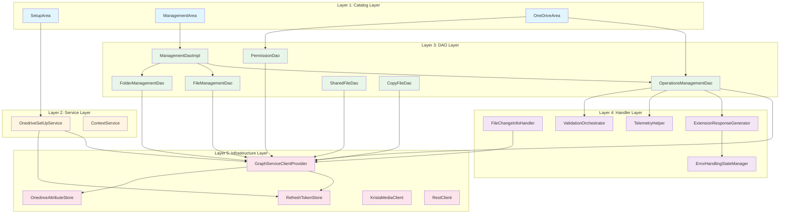
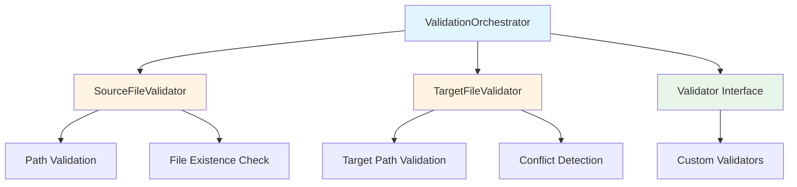
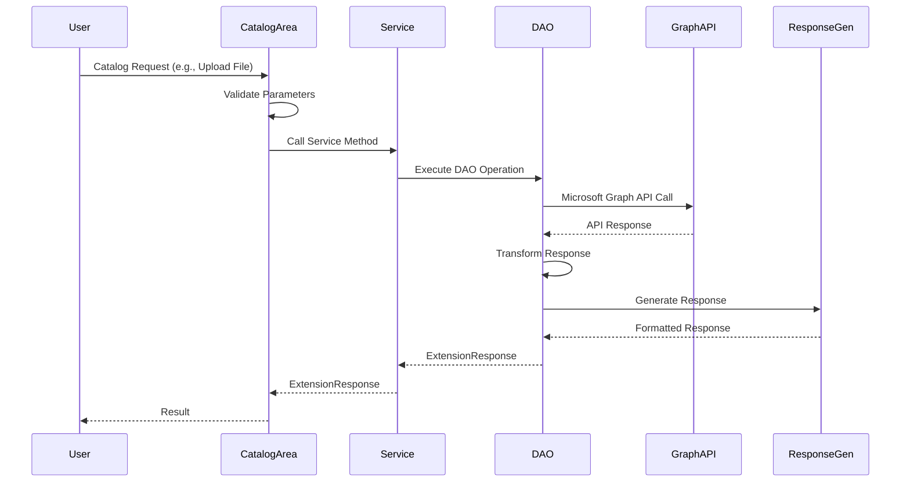
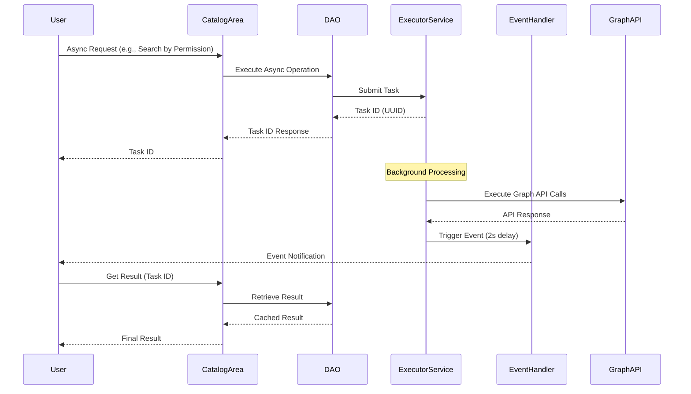
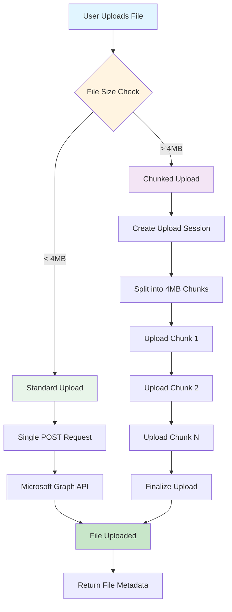
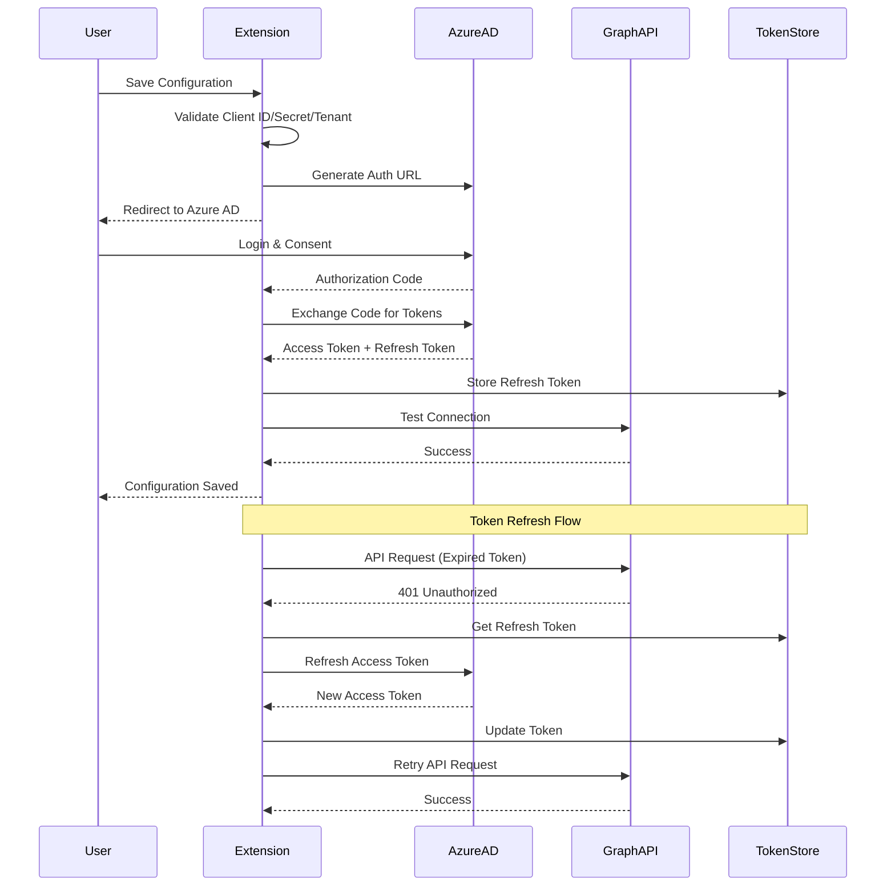
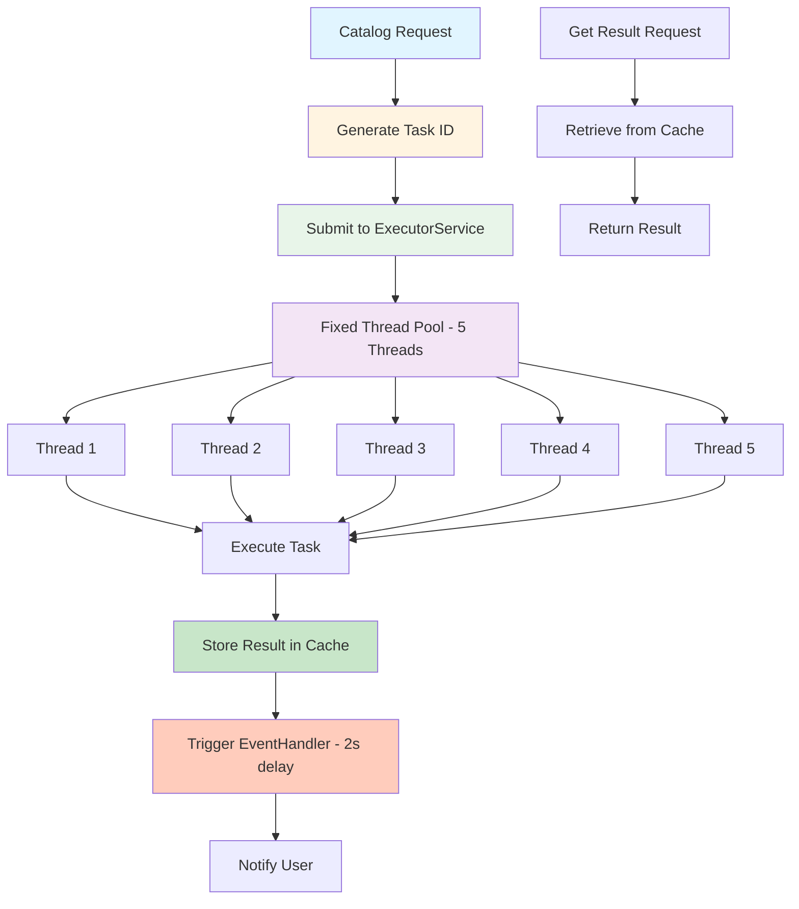
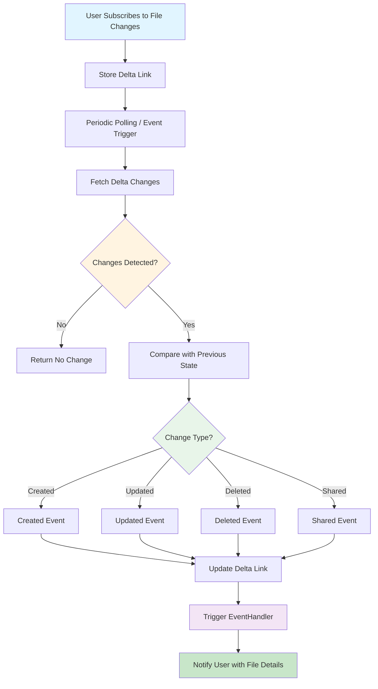
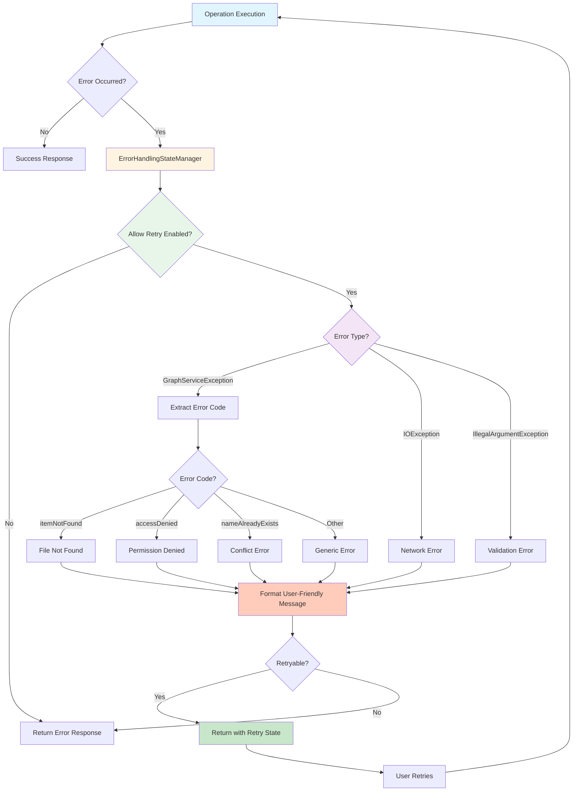

# Microsoft OneDrive Extension - Architecture Documentation

**Version:** 3.0.7
**Last Updated:** 2025-11-14
**Domain:** Cloud Files (Essentials Ecosystem)

---

## Table of Contents

1. [Overview](#overview)
2. [Architecture Layers](#architecture-layers)
3. [Component Architecture](#component-architecture)
4. [Data Flow Diagrams](#data-flow-diagrams)
5. [Authentication Flow](#authentication-flow)
6. [Asynchronous Task Pattern](#asynchronous-task-pattern)
7. [Event-Driven Architecture](#event-driven-architecture)
8. [Error Handling Architecture](#error-handling-architecture)
9. [Performance Characteristics](#performance-characteristics)
10. [System Limitations](#system-limitations)
11. [Error Scenarios and Solutions](#error-scenarios-and-solutions)
12. [Best Practices](#best-practices)

---

## Overview

The Microsoft OneDrive Extension provides comprehensive integration with Microsoft OneDrive cloud storage through the Microsoft Graph API v1.0. The extension follows a clean, layered architecture pattern with clear separation of concerns across five distinct layers.

### Key Capabilities

- **File Operations**: Upload, download, copy, move, rename, delete files
- **Folder Management**: List files/folders, create folders, get folder statistics
- **Permission-Based Search**: Search files by access level (Read, Write, Read and Write, Own)
- **Event-Driven Monitoring**: Real-time file change notifications (Created, Updated, Deleted, Shared)
- **Asynchronous Processing**: Task-based architecture for long-running operations
- **OAuth 2.0 Authentication**: Secure authentication via Microsoft Azure AD

### Extension Metadata

| Property | Value |
|----------|-------|
| Extension ID | `catEntryDomain_30c63e77-37f2-4a1d-afd8-f6bfda07ad57` |
| Domain | Cloud Files |
| Ecosystem | Essentials |
| Total Catalog Requests | 23 |
| Areas | 3 (Setup, Management, OneDrive) |
| Authentication | OAuth 2.0 (Microsoft Azure AD) |
| API Integration | Microsoft Graph API v1.0 |

---

## Architecture Layers

The OneDrive extension implements a **5-layer architecture** pattern:



### Layer 1: Catalog Layer

**Purpose**: Exposes catalog requests to the Krista platform

**Components**:
- `SetupArea` - Configuration and connection management (3 requests)
- `ManagementArea` - File and folder operations (18 requests)
- `OneDriveArea` - OneDrive-specific operations (2 requests)

**Responsibilities**:
- Request parameter validation
- Parameter extraction and type conversion
- Response formatting
- Catalog request annotations (@CatalogRequest, @Field)
- Dependency injection coordination

### Layer 2: Service Layer

**Purpose**: Business logic orchestration

**Components**:
- `OnedriveSetUpService` - Setup, configuration, health checks, connection testing
- `ContextService` - Request context, account information, routing URLs

**Responsibilities**:
- Orchestrate operations across multiple DAOs
- Implement business rules and workflows
- Manage authentication and authorization
- Handle health checks and connection testing
- Coordinate subscription management

### Layer 3: DAO Layer

**Purpose**: Data access and Microsoft Graph API interactions

**Components**:
- `OperationsManagementDao` - Core file operations (upload, download, read, write)
- `PermissionDao` - Permission-based file queries
- `FileManagementDao` - File-specific operations
- `FolderManagementDao` - Folder-specific operations
- `SharedFileDao` - Shared file operations
- `CopyFileDao` - File copy operations
- `ManagementDaoImpl` - Unified management facade

**Responsibilities**:
- Execute Microsoft Graph API calls
- Handle API responses and errors
- Implement retry logic
- Manage pagination
- Transform API responses to domain entities

### Layer 4: Handler Layer

**Purpose**: Specialized processing and cross-cutting concerns

**Components**:
- `FileChangeInfoHandler` - File change event processing
- `ExtensionResponseGenerator` - Response formatting and generation
- `ErrorHandlingStateManager` - Error state management
- `TelemetryHelper` - Metrics and monitoring
- `ValidationOrchestrator` - Validation coordination

**Responsibilities**:
- Process file change events
- Generate standardized responses
- Manage error states
- Track telemetry metrics
- Coordinate validation logic

### Layer 5: Infrastructure Layer

**Purpose**: Core infrastructure services

**Components**:
- `GraphServiceClientProvider` - Microsoft Graph API client management
- `RefreshTokenStore` - OAuth token storage and management
- `OnedriveAttributeStore` - Configuration attribute storage
- `KristaMediaClient` - Krista media server integration
- `RestClient` - HTTP client for REST calls

**Responsibilities**:
- Manage Graph API client lifecycle
- Handle OAuth token refresh
- Store and retrieve configuration
- Integrate with Krista media server
- Execute HTTP requests

---

## Component Architecture

### Dependency Injection (HK2)

The extension uses HK2 framework for dependency injection:

```mermaid
graph LR
    A[@Service] --> B[HK2 Container]
    C[@Inject] --> B
    B --> D[Component Instance]

    style A fill:#e1f5ff
    style B fill:#fff4e1
    style C fill:#e8f5e9
    style D fill:#f3e5f5
```

**Key Annotations**:
- `@Service` - Marks class as injectable service
- `@Inject` - Constructor injection
- Singleton scope by default

**Injected Components**:
- OnedriveSetUpService
- OperationsManagementDao
- PermissionDao
- GraphServiceClientProvider
- RefreshTokenStore
- TelemetryHelper
- ExtensionResponseGenerator
- ErrorHandlingStateManager

### Validator Architecture



**Validation Flow**:
1. `ValidationOrchestrator` coordinates validation
2. Specific validators execute checks
3. Validation results aggregated
4. Errors formatted by `ExtensionResponseGenerator`

---

## Data Flow Diagrams

### Synchronous Request Flow



**Example Operations**: Upload, Download, Copy, Move, Delete, Rename

**Typical Response Time**: 1-10 seconds

### Asynchronous Request Flow (Task-Based)



**Example Operations**: Search by Permission, When File Changed

**Thread Pool**: Fixed pool of 5 threads

**Event Delay**: 2 seconds before EventHandler trigger

**Task ID TTL**: ~1 hour (estimated)

### File Upload Flow (Large Files)



**Upload Limits**:
- Standard Upload: Up to 4MB
- Chunked Upload: 4MB - 10GB
- Chunk Size: 4MB
- Max File Size: 10GB


---

## Authentication Flow

### OAuth 2.0 Authorization Code Flow



**Token Management**:
- **Access Token Validity**: 1 hour
- **Refresh Token**: Long-lived (no expiry)
- **Auto-Refresh**: Automatic on 401 errors
- **Storage**: RefreshTokenStore (in-memory)

**Required Azure AD Permissions**:
- `Files.ReadWrite.All`
- `User.Read`
- `offline_access`

---

## Asynchronous Task Pattern

### Task Execution Architecture



**Task Pattern Components**:

1. **Task ID Generation**: UUID.randomUUID()
2. **ExecutorService**: Fixed thread pool (5 threads)
3. **ThreadLocalProxy**: Maintains context across threads
4. **Result Cache**: In-memory storage (Map-based)
5. **EventHandler**: Triggers event after 2-second delay

**Async Operations**:
- Search by Permission
- When File Changed (event monitoring)
- Large file uploads (chunked)

**Concurrency Limits**:
- Max Concurrent Tasks: 5
- Queue: Unbounded (LinkedBlockingQueue)

---

## Event-Driven Architecture

### File Change Monitoring



**Delta API Integration**:
- **Endpoint**: `/me/drive/root/delta`
- **Delta Link**: Stored for incremental changes
- **Change Types**: Created, Updated, Deleted, Shared
- **Storage**: FileChangeResourceUtil (REST-based storage)

**Event Payload**:
```json
{
  "Event": "Created|Updated|Deleted|Shared",
  "File": {
    "Name": "document.txt",
    "Path": "/Documents/document.txt",
    "Size": 1024,
    "Modified": "2025-11-14T10:30:00Z"
  }
}
```


---

## Error Handling Architecture

### Error Handling Flow



### Error Categories

#### 1. Graph API Errors

| Error Code | Description | User Message | Retryable |
|------------|-------------|--------------|-----------|
| `itemNotFound` | File/folder not found | "We couldn't find the file or folder you're looking for..." | No |
| `accessDenied` | Permission denied | "You don't have permission to access this resource..." | No |
| `nameAlreadyExists` | File/folder already exists | "A file with this name already exists..." | No |
| `unauthenticated` | Authentication failed | "Please sign in again..." | Yes |
| `generalException` | Generic error | "We're experiencing issues connecting to Microsoft OneDrive..." | Yes |

#### 2. Network Errors

| Error Type | Description | User Message | Retryable |
|------------|-------------|--------------|-----------|
| `IOException` | Network connectivity | "Connection error. Please check your network..." | Yes |
| `SocketTimeoutException` | Request timeout | "Request timed out. Please try again..." | Yes |

#### 3. Validation Errors

| Error Type | Description | User Message | Retryable |
|------------|-------------|--------------|-----------|
| `IllegalArgumentException` | Invalid parameters | "Please provide valid input..." | No |
| `NullPointerException` | Missing required field | "Required field is missing..." | No |

### Allow Retry Feature

**Constant**: `Constants.ENABLE_ERROR_HANDLING = "Allow Retry"`

**Mechanism**:
1. User enables "Allow Retry" in catalog request
2. On error, `ErrorHandlingStateManager` evaluates retry eligibility
3. If retryable, response includes retry state
4. User can retry operation with same parameters

**Retryable Scenarios**:
- Network errors (IOException, SocketTimeoutException)
- Authentication errors (401, 403 with token refresh)
- Rate limiting (429 - Too Many Requests)
- Server errors (500, 502, 503, 504)

**Non-Retryable Scenarios**:
- File not found (404)
- Permission denied (403 - non-auth)
- Validation errors (400)
- Conflict errors (409)

---

## Performance Characteristics

### Throughput Metrics

| Operation | Avg Response Time | Max Throughput | Notes |
|-----------|-------------------|----------------|-------|
| Upload File (< 4MB) | 2-5 seconds | 10 files/min | Single request |
| Upload File (> 4MB) | 10-60 seconds | 2 files/min | Chunked upload |
| Download File (< 50MB) | 3-10 seconds | 5 files/min | Direct download |
| Download File (> 50MB) | N/A | N/A | URL-based only |
| List Files | 1-3 seconds | 20 requests/min | Pagination applied |
| Copy File | 5-30 seconds | 5 files/min | Async operation |
| Move File | 2-8 seconds | 10 files/min | Metadata update |
| Delete File | 1-3 seconds | 15 files/min | Single request |
| Search by Permission | 10-60 seconds | 2 requests/min | Async, full scan |

### Resource Utilization

**Thread Pool**:
- Fixed pool size: 5 threads
- Queue: Unbounded LinkedBlockingQueue
- Thread lifecycle: Persistent (no timeout)

**Memory**:
- Token storage: ~1KB per account
- File metadata cache: ~10KB per 100 files
- Delta link storage: ~2KB per subscription
- Task result cache: ~50KB per task (estimated)

**Network**:
- Graph API calls: REST over HTTPS
- Typical payload: 1-100KB (metadata)
- File transfer: Streaming (no memory buffering for large files)

### Scalability Limits

| Resource | Limit | Impact |
|----------|-------|--------|
| Concurrent Async Tasks | 5 | Additional tasks queued |
| File Upload Size | 10GB | Larger files rejected |
| Chunk Size | 4MB | Fixed, not configurable |
| API Rate Limit | ~1000 req/hour | Throttling applied by Microsoft |
| Token Refresh | 1 hour | Automatic refresh |

---

## System Limitations

### Functional Limitations

1. **File Size Constraints**
   - Standard upload: Max 4MB
   - Chunked upload: Max 10GB
   - Download direct: Max 50MB (larger files via URL only)

2. **File Type Restrictions**
   - Read/Write operations: `.txt` files only
   - Other file types: Download/upload only (no content manipulation)

3. **Permission Model**
   - Search by permission: Full drive scan (slow for large drives)
   - Permission levels: Read, Write, Read and Write, Own
   - No granular permission management

4. **Event Monitoring**
   - Delta API: Incremental changes only
   - No real-time webhooks (polling-based)
   - Event delay: 2 seconds minimum

5. **Concurrency**
   - Max 5 concurrent async operations
   - No distributed task execution
   - Single-instance limitation

### Technical Limitations

1. **Authentication**
   - OAuth 2.0 only (no service principal support)
   - Single account per extension instance
   - Token storage: In-memory (lost on restart)

2. **API Integration**
   - Microsoft Graph API v1.0 only
   - No beta endpoint support
   - Rate limiting: Microsoft-imposed (not configurable)

3. **Error Recovery**
   - No automatic retry (requires user action)
   - No circuit breaker pattern
   - No exponential backoff

4. **Monitoring**
   - Basic telemetry only
   - No distributed tracing
   - No performance metrics dashboard

---

## Error Scenarios and Solutions

### Scenario 1: Authentication Failure

**Symptoms**:
- Error: "You're not authorized to access this resource"
- HTTP 401 or 403 responses

**Root Causes**:
1. Expired access token
2. Invalid client credentials
3. Insufficient permissions
4. Revoked consent

**Solutions**:
1. **Automatic Token Refresh**: Extension automatically refreshes access token on 401
2. **Re-authentication**: User re-authenticates via "Save Configuration"
3. **Permission Check**: Verify Azure AD app has required permissions
4. **Consent Re-grant**: User re-grants consent in Azure AD

**Prevention**:
- Monitor token expiry
- Implement health checks
- Log authentication errors

### Scenario 2: File Not Found

**Symptoms**:
- Error: "We couldn't find the file or folder you're looking for"
- Graph API error code: `itemNotFound`

**Root Causes**:
1. File deleted or moved
2. Incorrect file path
3. Permission change (file no longer accessible)
4. Typo in file name

**Solutions**:
1. **Path Validation**: Use `SourceFileValidator` to verify path before operation
2. **List Files First**: Retrieve file list to confirm existence
3. **Case Sensitivity**: Ensure correct case (OneDrive is case-insensitive but preserves case)
4. **Refresh File List**: Re-fetch file list if stale

**Prevention**:
- Validate paths before operations
- Use file IDs instead of paths (more reliable)
- Implement file existence checks

### Scenario 3: Network Connectivity Issues

**Symptoms**:
- Error: "We're experiencing issues connecting to Microsoft OneDrive"
- IOException, SocketTimeoutException

**Root Causes**:
1. Network outage
2. Firewall blocking
3. DNS resolution failure
4. Microsoft Graph API downtime

**Solutions**:
1. **Enable Allow Retry**: User retries operation after network recovery
2. **Check Network**: Verify internet connectivity
3. **Firewall Rules**: Ensure `graph.microsoft.com` is whitelisted
4. **Health Check**: Use "Test Connection" to verify connectivity

**Prevention**:
- Implement connection pooling
- Configure appropriate timeouts
- Monitor Microsoft Graph API status

### Scenario 4: File Already Exists

**Symptoms**:
- Error: "A file with this name already exists at the destination"
- Graph API error code: `nameAlreadyExists`

**Root Causes**:
1. Duplicate file name in target folder
2. Previous operation not completed
3. Concurrent operations

**Solutions**:
1. **Rename File**: Use different file name
2. **Delete Existing**: Delete existing file first (if appropriate)
3. **Overwrite**: Use update operation instead of create
4. **Conflict Resolution**: Implement versioning or timestamp-based naming

**Prevention**:
- Check file existence before upload
- Use unique file names (e.g., timestamp suffix)
- Implement conflict resolution strategy

### Scenario 5: Permission Denied

**Symptoms**:
- Error: "You don't have permission to download/share this file"
- Graph API error code: `accessDenied`

**Root Causes**:
1. Insufficient file permissions
2. Organization policy restrictions
3. File sharing disabled
4. User not file owner

**Solutions**:
1. **Request Access**: Contact file owner for permission
2. **Check Permissions**: Verify user has required access level
3. **Organization Policy**: Contact administrator for policy exceptions
4. **Alternative Method**: Use different operation (e.g., view instead of download)

**Prevention**:
- Validate permissions before operations
- Implement permission checks
- Provide clear error messages

### Scenario 6: Large File Upload Failure

**Symptoms**:
- Upload fails for files > 4MB
- Timeout errors during chunked upload

**Root Causes**:
1. Network interruption during upload
2. Session expiry
3. Chunk upload failure
4. File size exceeds 10GB limit

**Solutions**:
1. **Resume Upload**: Re-create upload session and resume
2. **Reduce File Size**: Compress file or split into smaller files
3. **Check Network**: Ensure stable connection
4. **Increase Timeout**: Configure longer timeout for large files

**Prevention**:
- Validate file size before upload
- Implement upload progress tracking
- Use resumable upload sessions

---

## Best Practices

### Development Best Practices

1. **Use Dependency Injection**
   - Inject services via constructor
   - Avoid static dependencies
   - Use @Service and @Inject annotations

2. **Implement Proper Validation**
   - Validate all input parameters
   - Use ValidationOrchestrator for complex validation
   - Return user-friendly error messages

3. **Handle Errors Gracefully**
   - Catch specific exceptions (GraphServiceException, IOException)
   - Use ErrorHandlingStateManager for retry logic
   - Log errors with context

4. **Optimize Performance**
   - Use pagination for large result sets
   - Implement caching where appropriate
   - Avoid unnecessary API calls

5. **Follow Naming Conventions**
   - Use descriptive variable names
   - Follow Java naming standards
   - Document complex logic with Javadoc

### Operational Best Practices

1. **Monitor Token Expiry**
   - Implement health checks
   - Monitor authentication errors
   - Proactively refresh tokens

2. **Implement Rate Limiting**
   - Respect Microsoft Graph API limits
   - Implement backoff strategy
   - Monitor API usage

3. **Secure Credentials**
   - Never hardcode client secrets
   - Use secure storage for tokens
   - Rotate credentials regularly

4. **Test Thoroughly**
   - Unit test all components
   - Integration test with real API
   - Test error scenarios

5. **Document Configuration**
   - Provide clear setup instructions
   - Document required permissions
   - Include troubleshooting guide

### Security Best Practices

1. **OAuth 2.0 Best Practices**
   - Use authorization code flow
   - Request minimum required permissions
   - Validate state parameter

2. **Token Management**
   - Store tokens securely
   - Implement token rotation
   - Clear tokens on logout

3. **Input Validation**
   - Sanitize all user inputs
   - Validate file paths
   - Prevent path traversal attacks

4. **Error Messages**
   - Don't expose sensitive information
   - Provide generic error messages
   - Log detailed errors server-side

---

## Appendix

### Key Constants

| Constant | Value | Purpose |
|----------|-------|---------|
| `ENABLE_ERROR_HANDLING` | "Allow Retry" | Enable retry functionality |
| `DRIVE_ROOT` | "drive/root:/" | OneDrive root path |
| `FILE_SIZE_LIMIT` | 50MB | Direct download limit |
| `CHUNK_SIZE` | 4MB | Upload chunk size |
| `MAX_FILE_SIZE` | 10GB | Maximum upload size |
| `THREAD_POOL_SIZE` | 5 | Async task thread pool |
| `EVENT_DELAY` | 2 seconds | EventHandler delay |

### Graph API Endpoints

| Operation | Endpoint | Method |
|-----------|----------|--------|
| List Files | `/me/drive/root/children` | GET |
| Get File | `/me/drive/items/{item-id}` | GET |
| Upload File | `/me/drive/root:/{path}:/content` | PUT |
| Download File | `/me/drive/items/{item-id}/content` | GET |
| Delete File | `/me/drive/items/{item-id}` | DELETE |
| Copy File | `/me/drive/items/{item-id}/copy` | POST |
| Move File | `/me/drive/items/{item-id}` | PATCH |
| Delta Changes | `/me/drive/root/delta` | GET |
| Create Upload Session | `/me/drive/root:/{path}:/createUploadSession` | POST |

### Component Reference

#### Catalog Layer Components

| Component | Requests | Purpose |
|-----------|----------|---------|
| SetupArea | 3 | Configuration, connection testing, health checks |
| ManagementArea | 18 | File/folder operations (CRUD, list, copy, move) |
| OneDriveArea | 2 | Permission-based search, custom file operations |

#### Service Layer Components

| Component | Purpose | Key Methods |
|-----------|---------|-------------|
| OnedriveSetUpService | Setup and configuration | saveConfiguration(), testConnection(), healthCheck() |
| ContextService | Request context management | getAccountId(), getRoutingUrl() |

#### DAO Layer Components

| Component | Purpose | Key Operations |
|-----------|---------|----------------|
| OperationsManagementDao | Core file operations | upload, download, read, write |
| PermissionDao | Permission-based queries | getFileByPermission() |
| FileManagementDao | File-specific operations | rename, delete, get metadata |
| FolderManagementDao | Folder operations | create, list, get statistics |
| SharedFileDao | Shared file operations | createSharedLink() |
| CopyFileDao | File copy operations | copyFile() |
| ManagementDaoImpl | Unified facade | Delegates to specialized DAOs |

#### Handler Layer Components

| Component | Purpose | Key Functionality |
|-----------|---------|-------------------|
| FileChangeInfoHandler | File change events | Delta API integration, change detection |
| ExtensionResponseGenerator | Response formatting | Success/error response generation |
| ErrorHandlingStateManager | Error state management | Retry eligibility, error categorization |
| TelemetryHelper | Metrics tracking | Performance metrics, operation logging |
| ValidationOrchestrator | Validation coordination | Multi-validator orchestration |

#### Infrastructure Layer Components

| Component | Purpose | Key Functionality |
|-----------|---------|-------------------|
| GraphServiceClientProvider | Graph API client | Client lifecycle, authentication |
| RefreshTokenStore | Token storage | In-memory token management |
| OnedriveAttributeStore | Configuration storage | Extension attributes |
| KristaMediaClient | Media server integration | File upload/download to Krista |
| RestClient | HTTP client | REST API calls |

### Useful Resources

- [Microsoft Graph API Documentation](https://docs.microsoft.com/en-us/graph/api/overview)
- [OneDrive API Reference](https://docs.microsoft.com/en-us/graph/api/resources/onedrive)
- [OAuth 2.0 Authorization Code Flow](https://docs.microsoft.com/en-us/azure/active-directory/develop/v2-oauth2-auth-code-flow)
- [Krista Extension Development Guide](https://docs.krista.ai/extensions)
- [HK2 Dependency Injection](https://javaee.github.io/hk2/)

---

**Document Version**: 1.0
**Last Updated**: 2025-11-14
**Maintained By**: Krista Extensions Team
**Extension Version**: 3.0.x
