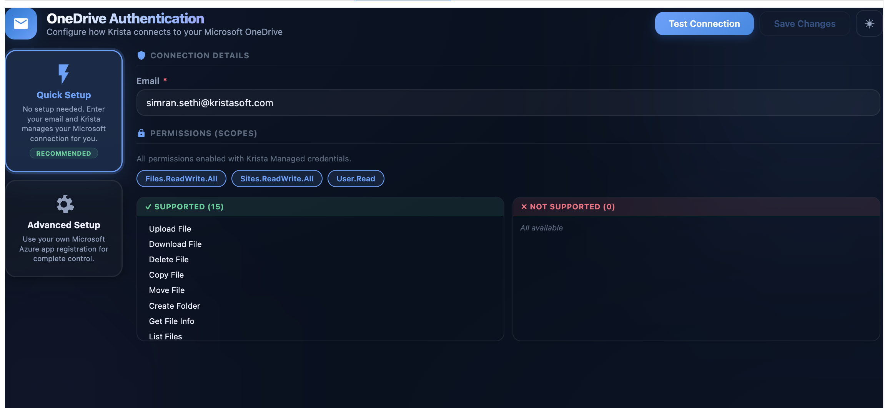
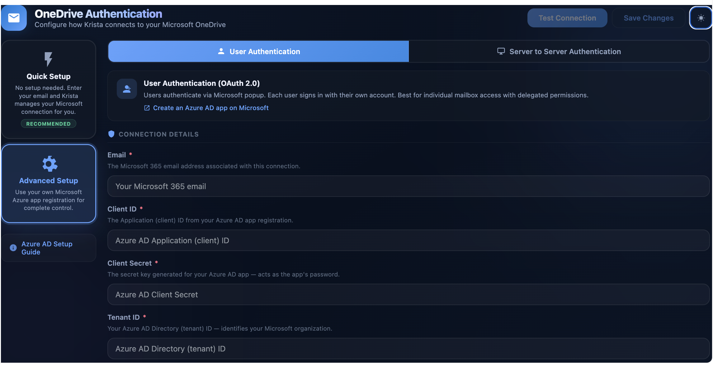
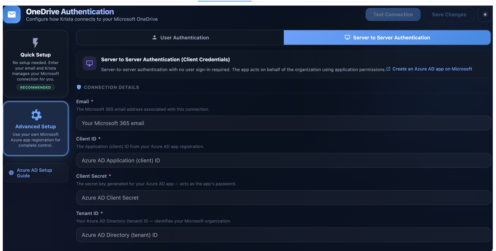

# Authentication Tab Guide — OneDrive Extension

This guide explains the three authentication types available in the OneDrive Authentication tab, how to create an Azure AD app registration for the two types that require it, and how to configure the extension settings.

---

## Authentication Types

The OneDrive authentication tab offers three modes. Choose the one that fits your deployment.

### 1. Quick Setup *(Recommended)*



**What it is:** Krista manages the Microsoft app credentials on your behalf. You only need to provide your Microsoft 365 email address and sign in — no Azure AD app registration is required.

**Best for:** Individual users or organizations that want the simplest setup and are comfortable using Krista's shared Microsoft application.

**Permissions granted (managed by Krista):**

| Scope | Purpose |
|---|---|
| `Files.ReadWrite.All` | Read and write all files in OneDrive |
| `Sites.ReadWrite.All` | Read and write all SharePoint sites and drives |
| `User.Read` | Sign in and read the user profile |

**Fields required:**
- Email (your Microsoft 365 email address)

---

### 2. User Authentication (OAuth 2.0)



**What it is:** Your organization provides its own Azure AD app registration. Each user authenticates individually via a Microsoft sign-in popup. Access is delegated — the app acts on behalf of the signed-in user.

**Best for:** Organizations that require their own Azure AD app for compliance, control over permissions, or custom redirect URIs.

**Fields required:**
- Email
- Client ID
- Client Secret
- Tenant ID (optional — leave blank for multi-tenant)

---

### 3. Server to Server Authentication (Client Credentials)



**What it is:** No user sign-in is required. The app authenticates directly with Microsoft using application-level permissions and accesses OneDrive files on behalf of the organization.

**Best for:** Automated workflows, background jobs, scheduled tasks, and service integrations where a human sign-in is not possible or desirable.

**Fields required:**
- Email (the Microsoft 365 email address associated with the connection)
- Client ID
- Client Secret
- Tenant ID

---

## Supported Operations

All 15 operations are supported across all three authentication types. There are no unsupported operations — everything is available regardless of which auth mode you choose.

| Operation | Quick Setup | User Auth | Server-Server |
|---|---|---|---|
| Upload File | ✓ | ✓ | ✓ |
| Download File | ✓ | ✓ | ✓ |
| Delete File | ✓ | ✓ | ✓ |
| Copy File | ✓ | ✓ | ✓ |
| Move File | ✓ | ✓ | ✓ |
| Create Folder | ✓ | ✓ | ✓ |
| Get File Info | ✓ | ✓ | ✓ |
| List Files | ✓ | ✓ | ✓ |
| Write with Custom File Name | ✓ | ✓ | ✓ |
| Search By Permissions | ✓ | ✓ | ✓ |
| Get File Versions | ✓ | ✓ | ✓ |
| Restore File Version | ✓ | ✓ | ✓ |
| Get File Permissions | ✓ | ✓ | ✓ |
| Set File Permissions | ✓ | ✓ | ✓ |
| Get Shared Files | ✓ | ✓ | ✓ |

---

## Creating an Azure AD App — User Authentication

Follow these steps in the [Azure Portal](https://portal.azure.com).

### Step 1: Register the app

1. Go to **Azure Active Directory** → **App registrations** → **New registration**.
2. Enter a name (e.g., `Krista OneDrive Integration`).
3. Under **Supported account types**, select:
   > **Accounts in any organizational directory (Any Azure AD directory – Multi-tenant)**
4. Under **Redirect URI**, select **Web** and enter:
   ```
   {your-routing-url}/{extensionId}/rest/onedrive/callback
   ```
   Replace `{your-routing-url}` with your Krista appliance URL and `{extensionId}` with the extension's unique identifier (both are shown in the Authentication tab after clicking **Authorize**).
   > **Tip:** The exact redirect URI is shown in the Authentication tab UI after you click **Authorize** — copy it from there to avoid typos.
5. Click **Register**.

### Step 2: Note your Client ID and Tenant ID

On the app's **Overview** page, copy:
- **Application (client) ID** → this is your **Client ID**
- **Directory (tenant) ID** → this is your **Tenant ID**

### Step 3: Create a Client Secret

1. Go to **Certificates & secrets** → **New client secret**.
2. Enter a description and choose an expiry duration.
3. Click **Add** and immediately copy the **Value** — it will not be shown again. This is your **Client Secret**.

### Step 4: Add API Permissions (Delegated)

1. Go to **API permissions** → **Add a permission** → **Microsoft Graph** → **Delegated permissions**.
2. Add the following permissions:

   | Permission | Purpose |
   |---|---|
   | `Files.ReadWrite.All` | Read and write all files in OneDrive |
   | `Sites.ReadWrite.All` | Read and write all SharePoint sites and drives |
   | `User.Read` | Sign in and read the user profile |
   | `offline_access` | Maintain access via refresh token |

3. Click **Grant admin consent** if your organization requires it.

---

## Creating an Azure AD App — Server to Server Authentication

Follow these steps in the [Azure Portal](https://portal.azure.com).

### Step 1: Register the app

1. Go to **Azure Active Directory** → **App registrations** → **New registration**.
2. Enter a name (e.g., `Krista OneDrive Service`).
3. Under **Supported account types**, select:
   > **Accounts in this organizational directory only (Single tenant)**
4. No redirect URI is needed — leave it blank.
5. Click **Register**.

### Step 2: Note your Client ID and Tenant ID

On the app's **Overview** page, copy:
- **Application (client) ID** → this is your **Client ID**
- **Directory (tenant) ID** → this is your **Tenant ID**

### Step 3: Create a Client Secret

1. Go to **Certificates & secrets** → **New client secret**.
2. Enter a description and choose an expiry duration.
3. Click **Add** and immediately copy the **Value** — it will not be shown again. This is your **Client Secret**.

### Step 4: Add API Permissions (Application)

1. Go to **API permissions** → **Add a permission** → **Microsoft Graph** → **Application permissions**.
2. Add the following permissions:

   | Permission | Purpose |
   |---|---|
   | `Files.ReadWrite.All` | Read and write files in all site collections |
   | `Sites.ReadWrite.All` | Read and write items in all site collections |
   | `User.Read.All` | Read all users' full profiles |

3. Click **Grant admin consent** — this is **required** for application permissions.

> **Note:** Application permissions grant access to all drives and sites in the tenant. Ensure your organization's security policy permits this before enabling Server to Server Authentication.

---

## Setting Up the Extension

### Quick Setup

1. Open the **Authentication** tab of the OneDrive extension.
2. The **Quick Setup** panel is selected by default on the left.
3. Enter your **Microsoft 365 email address** in the Email field.
4. Click **Authorize** — a Microsoft sign-in popup will open.
5. Sign in with your Microsoft account and grant the requested permissions.
6. On success, you are redirected back and the connection is saved automatically.
7. Click **Test Connection** to verify the setup.

---

### User Authentication (OAuth 2.0)

1. Open the **Authentication** tab and click **Advanced Setup** in the left panel.
2. Select the **User Authentication** tab at the top.
3. Fill in the fields:
   - **Email** — your Microsoft 365 email address
   - **Client ID** — Application (client) ID from your Azure AD app
   - **Client Secret** — the secret value you copied from Azure
   - **Tenant ID** — Directory (tenant) ID (leave blank for multi-tenant)
4. Click **Save Changes**.
5. Click **Authorize** — a Microsoft sign-in popup will open using your own app's credentials.
6. Sign in and grant the requested permissions.
7. Click **Test Connection** to verify the setup.

---

### Server to Server Authentication (Client Credentials)

1. Open the **Authentication** tab and click **Advanced Setup** in the left panel.
2. Select the **Server to Server Authentication** tab at the top.
3. Fill in the fields:
   - **Email** — the Microsoft 365 email address associated with the connection
   - **Client ID** — Application (client) ID from your Azure AD app
   - **Client Secret** — the secret value you copied from Azure
   - **Tenant ID** — Directory (tenant) ID of your organization
4. Click **Save Changes** — no OAuth redirect is required. The service authenticates silently using client credentials.
5. Click **Test Connection** to verify the setup.

---

## Troubleshooting

| Error | Likely Cause | Fix |
|---|---|---|
| `AADSTS50126` | Wrong password or account | Re-enter credentials or reset password |
| `AADSTS70008` / `AADSTS700082` | Refresh token expired | Click **Authorize** to re-authenticate |
| `AADSTS7000215` | Invalid Client Secret | Regenerate the secret in Azure and update |
| `AADSTS7000222` | Client Secret expired | Create a new secret in Azure and update |
| `AADSTS500011` | Redirect URI not registered | Ensure the redirect URI registered in Azure includes the extension ID path: `{routing-url}/{extensionId}/rest/onedrive/callback` |
| `AADSTS500112` | Redirect URI mismatch between authorize and token exchange | Re-save your credentials in the Authentication tab — this can happen when credentials were saved before the redirect URI was correctly persisted |
| `AADSTS16000` | Invalid token | Sign out and re-authorize the connection |
| `Insufficient privileges` | Missing API permissions or no admin consent | Add permissions and grant admin consent in Azure |
