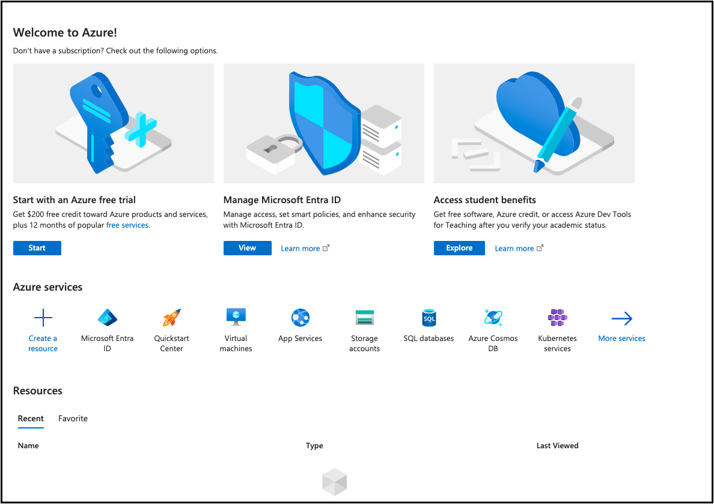
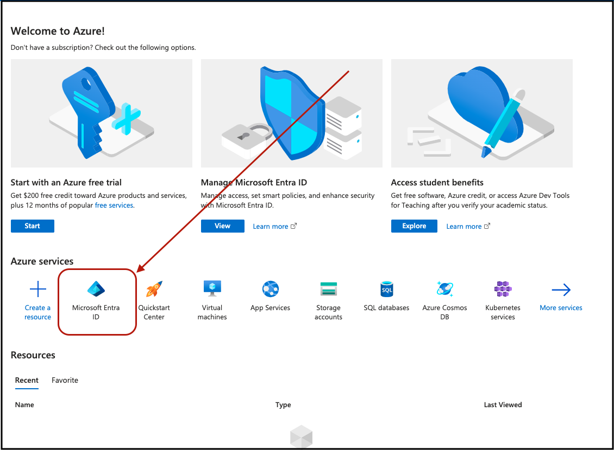
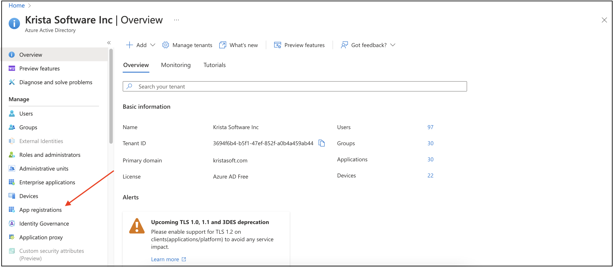
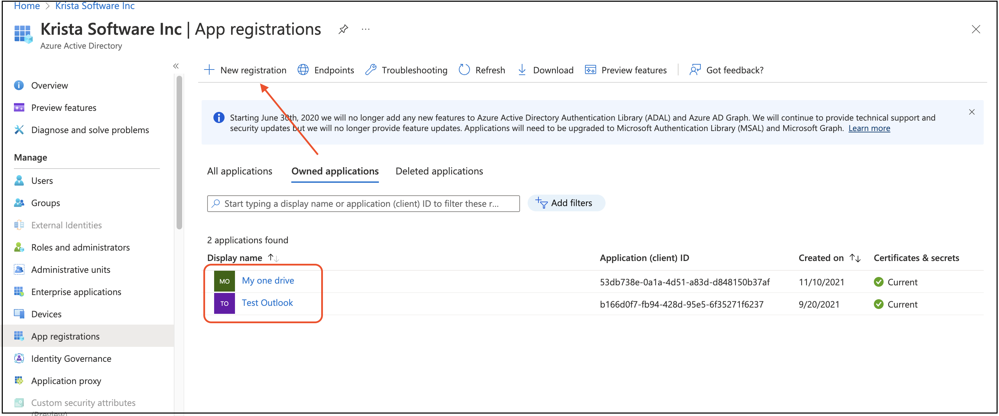
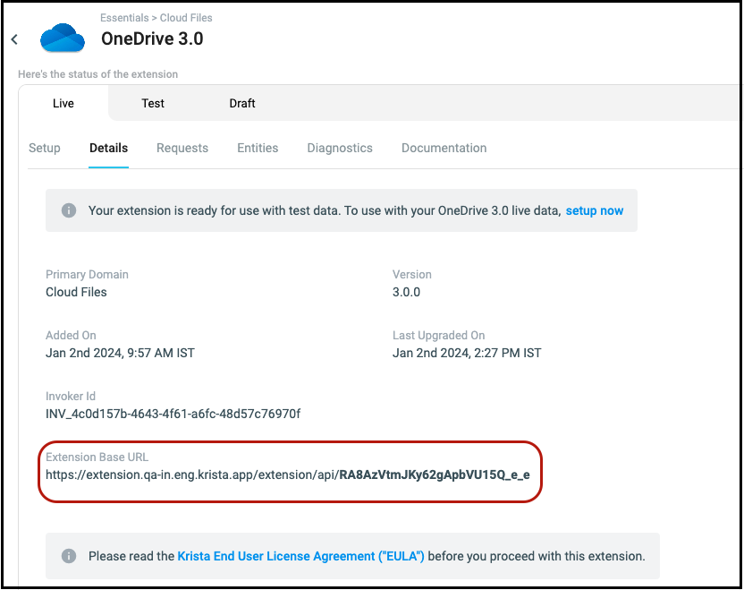
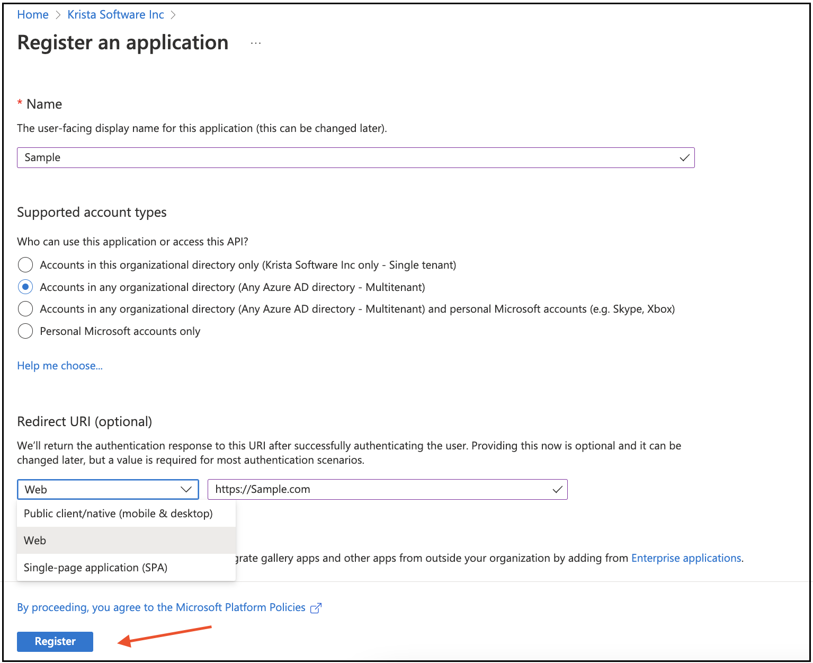
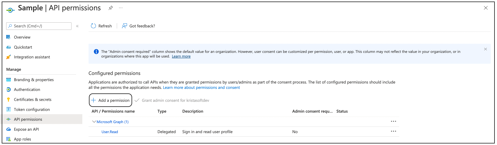
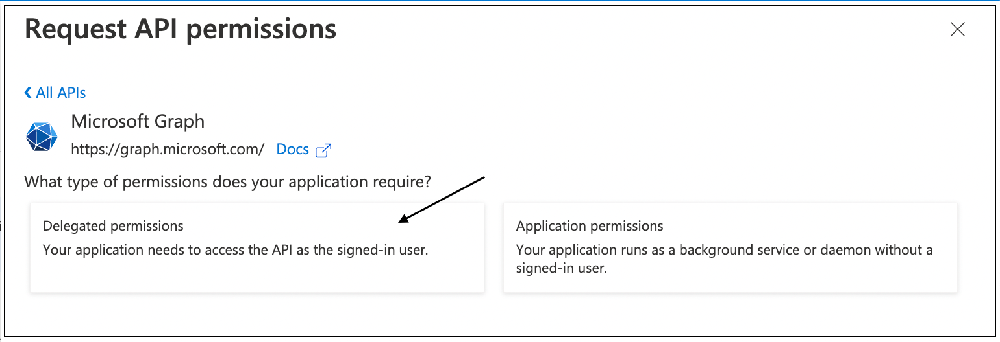
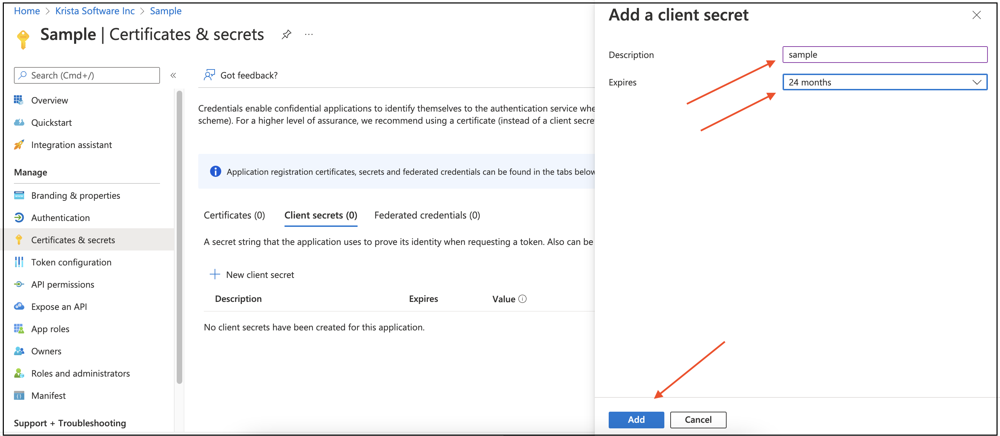
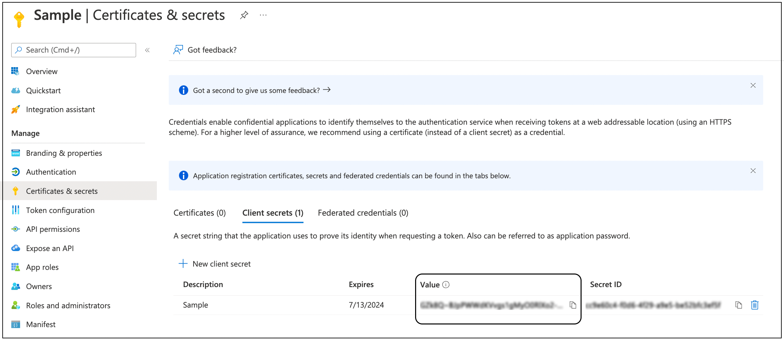

# Creating Microsoft App

## Overview

To use the OneDrive Files extension, you must register an application in Microsoft Azure Active Directory (Azure AD).
This application provides the credentials (Client ID, Client Secret, Tenant ID) required to authenticate and access
OneDrive resources.

## Prerequisites

Before you begin, ensure you have:

- A Microsoft 365 account with administrative access
- Access to the Azure Portal
- Permissions to register applications in Azure AD
- The OneDrive Files extension installed in Krista

## Step-by-Step Guide

### Step 1: Access Azure Portal

1. Navigate to the [Azure Portal](https://portal.azure.com/)
2. Sign in with your Microsoft 365 administrator account

### Step 2: Navigate to Microsoft Entra ID

1. On the Azure Portal home page, locate **Azure services**
2. Click **Microsoft Entra ID** (formerly Azure Active Directory)
3. If not visible, click **More services** to find it

### Step 3: Open App Registrations

1. On the Microsoft Entra ID Overview page, locate the left navigation menu
2. Under the **Manage** section, click **App registrations**

### Step 4: Create New Registration

1. At the top of the App registrations page, click **+ New registration**
2. Alternatively, if you have an existing application, you can open and configure it

### Step 5: Configure Application Registration

On the **Register an application** page, provide the following information:

#### Application Name

- **Field**: Name
- **Value**: Enter a descriptive name (e.g., "Krista OneDrive Files Extension")
- **Purpose**: This name will be displayed to users during consent

#### Supported Account Types

- **Field**: Supported account types
- **Selection**: Choose **Accounts in this organizational directory only (Single tenant)**
- **Purpose**: Restricts access to users in your organization only

#### Redirect URI

1. **Platform**: Select **Web** from the dropdown
2. **URI**: Enter your OneDrive extension callback URL

**How to get the Redirect URI**:

1. Open Krista Designer
2. Navigate to the OneDrive Files extension
3. Go to the extension **Details** page
4. Copy the **Routing ID**
5. Append `/rest/onedrive/callback` to the Routing ID
6. Example: `https://your-krista-instance.com/routing-id/rest/onedrive/callback`

7. Click **Register** to create the application

### Step 6: Copy Client ID and Tenant ID

After registration, you'll be redirected to the application's Overview page.

1. Locate the **Essentials** section
2. Copy the **Application (client) ID** - this is your **Client ID**
3. Copy the **Directory (tenant) ID** - this is your **Tenant ID**
4. Save these values securely - you'll need them to configure the extension

### Step 7: Configure API Permissions

The application needs specific Microsoft Graph API permissions to access OneDrive.

#### Add Permissions

1. In the left navigation menu, click **API permissions**
2. Under **Configured permissions**, click **+ Add a permission**

3. On the **Request API permissions** page, click **Microsoft Graph**

4. Select **Delegated permissions**

#### Select Required Permissions

Add the following delegated permissions:

| Permission              | Purpose                                                          |
|-------------------------|------------------------------------------------------------------|
| **Files.ReadWrite.All** | Read and write all files that user can access                    |
| **Sites.ReadWrite.All** | Read and write items in all site collections (for shared drives) |
| **offline_access**      | Maintain access to data (enables refresh tokens)                 |
| **openid**              | Sign in and read user profile                                    |
| **profile**             | View user's basic profile                                        |
| **User.Read**           | Sign in and read user profile                                    |

**To add each permission**:

1. Start typing the permission name in the search box
2. Expand the permission category when it appears
3. Check the checkbox next to the permission
4. Click **Add permissions** at the bottom

#### Grant Admin Consent (If Required)

Some permissions may require administrator consent:

1. After adding all permissions, review the **Configured permissions** list
2. If you see "Admin consent required" status, click **Grant admin consent for [Your Organization]**
3. Confirm the consent when prompted

### Step 8: Create Client Secret

The Client Secret is used to authenticate your application.

1. In the left navigation menu, click **Certificates & secrets**
2. Under the **Client secrets** tab, click **+ New client secret**

3. On the **Add a client secret** panel:
    - **Description**: Enter a description (e.g., "Krista OneDrive Extension Secret")
    - **Expires**: Select an expiration period (recommended: 6-12 months)
4. Click **Add**

5. **IMPORTANT**: Copy the **Value** immediately - this is your **Client Secret**
6. The secret value will not be shown again after you leave this page
7. Save this value securely

### Step 9: Configure Redirect URI (Additional Settings)

Ensure the redirect URI is properly configured:

1. In the left navigation menu, click **Authentication**
2. Under **Platform configurations**, verify the **Web** platform is listed
3. Verify your redirect URI is listed under **Redirect URIs**
4. Under **Implicit grant and hybrid flows**, ensure the following are **NOT** checked:
    - Access tokens
    - ID tokens
5. Click **Save** if you made any changes

## Configuration Summary

After completing all steps, you should have the following values:

| Parameter         | Where to Find                                   | Example                                                       |
|-------------------|-------------------------------------------------|---------------------------------------------------------------|
| **Client ID**     | App Overview → Application (client) ID          | `a1b2c3d4-e5f6-7890-abcd-ef1234567890`                        |
| **Client Secret** | Certificates & secrets → Client secrets → Value | `abc123~DEF456.ghi789`                                        |
| **Tenant ID**     | App Overview → Directory (tenant) ID            | `9876fedc-ba09-8765-4321-0fedcba98765`                        |
| **Redirect URI**  | Authentication → Redirect URIs                  | `https://your-instance.com/routing-id/rest/onedrive/callback` |

## Next Steps

Now that you have created the Azure AD application:

1. **Configure the extension** in Krista using [Extension Configuration](pages/ExtensionConfiguration.md)
2. **Enter the credentials**:
    - Client ID
    - Client Secret
    - Tenant ID
    - Email (your Microsoft 365 email)
3. **Validate the connection** using [Save Configuration](pages/SaveConfiguration.md)
4. **Test connectivity** using [Test Connection](pages/TestConnection.md)

## Security Best Practices

### Client Secret Management

- **Rotate secrets regularly**: Set expiration dates and rotate before expiry
- **Use separate apps**: Create different apps for development and production
- **Limit access**: Only share credentials with authorized personnel
- **Monitor usage**: Review Azure AD sign-in logs regularly

### Application Security

- **Restrict account types**: Use single-tenant unless multi-tenant is required
- **Minimum permissions**: Only grant necessary permissions
- **Enable conditional access**: Use Azure AD conditional access policies if available
- **Audit regularly**: Review app permissions and usage periodically

## Troubleshooting

### Issue: Cannot Create App Registration

**Possible Causes**:

- Insufficient permissions in Azure AD
- Organization policy restricts app registration

**Solutions**:

- Contact your Azure AD administrator
- Request "Application Developer" role or higher
- Check organization's app registration policies

### Issue: Cannot Grant Admin Consent

**Possible Causes**:

- Not an administrator
- Organization requires specific approval process

**Solutions**:

- Contact your Azure AD Global Administrator
- Request admin consent for the application
- Follow your organization's approval process

### Issue: Client Secret Not Visible

**Possible Causes**:

- Navigated away from the page after creating secret
- Secret was not copied immediately

**Solutions**:

- Create a new client secret
- Delete the old secret if necessary
- Copy the new secret value immediately

### Issue: Redirect URI Mismatch

**Possible Causes**:

- Incorrect redirect URI format
- Routing ID changed in Krista
- URI not properly configured

**Solutions**:

- Verify the redirect URI format: `{routing-id}/rest/onedrive/callback`
- Ensure the URI matches exactly (including https://)
- Update the redirect URI in Azure AD if Routing ID changed

## Additional Resources

- [Microsoft Identity Platform Documentation](https://docs.microsoft.com/en-us/azure/active-directory/develop/)
- [Microsoft Graph API Permissions Reference](https://docs.microsoft.com/en-us/graph/permissions-reference)
- [Azure AD App Registration Best Practices](https://docs.microsoft.com/en-us/azure/active-directory/develop/security-best-practices-for-app-registration)

## See Also

- [Extension Configuration](pages/ExtensionConfiguration.md) - Configure the extension with Azure AD credentials
- [Authentication](pages/Authentication.md) - Understand OAuth 2.0 authentication flow
- [Save Configuration](pages/SaveConfiguration.md) - Validate and save credentials
- [Test Connection](pages/TestConnection.md) - Verify connectivity

